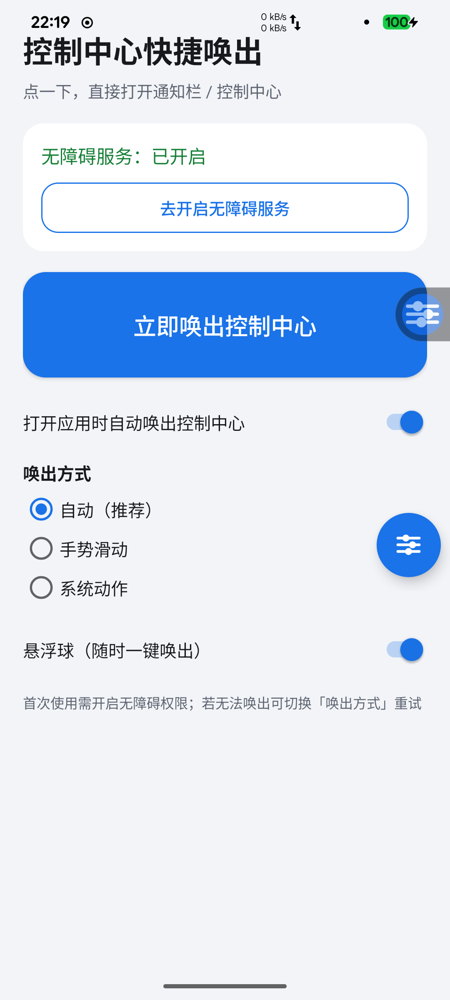
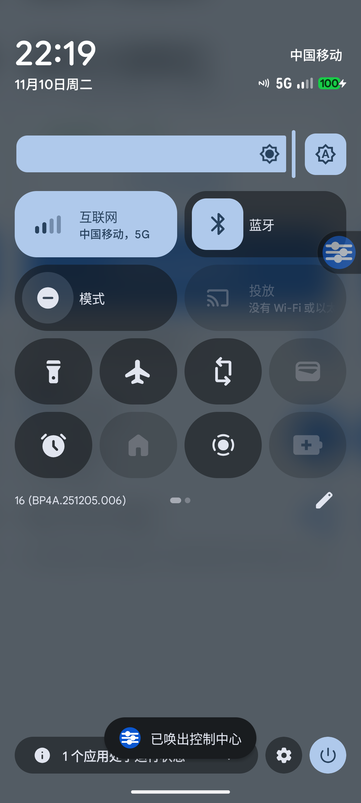

# ControlCenterApp · 控制中心快捷唤出

> 一键唤出 Android 控制中心（快捷设置面板）的极简 App。纯 Java + Android SDK 实现，**不依赖 Gradle / AndroidX / 任何第三方库**。

[](https://developer.android.com)
[](https://openjdk.org)
[](#-构建)

普通 App 无权直接展开状态栏，本项目通过**无障碍服务**调用系统全局动作 `GLOBAL_ACTION_QUICK_SETTINGS`，实现「点一下 = 展开完整控制中心」。已在一台 Xiaomi 12（Android 16）上真机验证。

## 📥 下载

- 直接下载 APK：[ControlCenter-1.0.apk](https://github.com/zhoukg/control-center-quick-launch/releases/download/v1.0/ControlCenter-1.0.apk)（来自 [v1.0 Release](https://github.com/zhoukg/control-center-quick-launch/releases/tag/v1.0)）

> 安装后需到「设置 → 无障碍 → 已下载的应用」开启「控制中心快捷唤出」，之后打开 App 即可自动唤出控制中心。

## ✨ 功能

- **点桌面图标即唤出**：打开 App 自动展开控制中心（冷启动 / 从后台回来都生效）
- **主界面大按钮**：「立即唤出控制中心」
- **悬浮球**：可拖动的蓝色小圆球，点一下唤出，长按打开 App，位置自动记忆
- **桌面小组件**：1×1 小组件，点一下唤出
- **外部触发广播**：可被 Tasker / 快捷指令 / adb 调用
  ```bash
  adb shell am broadcast -a com.dsh.controlcenter.ACTION_SUMMON -p com.dsh.controlcenter
  ```
- **三种唤出方式**：自动（系统动作优先、手势兜底）/ 手势滑动 / 系统动作

## 📸 截图

| App 界面 | 一键唤出控制中心 |
| :---: | :---: |
|  |  |

## 🚀 快速开始

### 构建

环境要求：

- JDK 17+（本项目用 21 构建）
- Android SDK：`build-tools 36.0.0`、`platforms/android-37.0`

```bash
bash build.sh
```

产物：`dist/ControlCenter-1.0.apk`（自签名，密钥 `keys/release.jks`，口令 `controlcenter`，仅用于开发测试）。

构建链（无 Gradle）：

```
aapt2 compile/link → javac --release 17 → d8 → 合并 classes.dex → zipalign → apksigner
```

### 安装到手机（自动完成授权）

```bash
bash tools/install.sh
```

脚本会依次：安装 APK → 授予「悬浮窗 / 通知」权限 → 开启无障碍服务（轮询确认已生效）→ 启动 App 并自动唤出控制中心。

> 覆盖安装后 Android 可能会重置该 App 的无障碍开关，脚本已做自动重试；若仍失败，请到「设置 → 无障碍 → 已下载的应用」手动开启「控制中心快捷唤出」。

## 🧠 原理

| 方式 | 实现 |
| --- | --- |
| 系统动作（默认） | `AccessibilityService.performGlobalAction(GLOBAL_ACTION_QUICK_SETTINGS)` 直接展开完整控制中心 |
| 手势兜底 | `dispatchGesture` 从左上角向下滑动（单次下滑展开通知面板，与系统行为一致） |
| 悬浮球 / 小组件 / 广播 | 先 `summon` 到已连接的无障碍服务，再执行上述动作 |

无障碍服务配置：`canPerformGestures=true`、`canRetrieveWindowContent=false`（不读取屏幕内容）。

## 📁 项目结构

```
ControlCenterApp/
├── app/src/main/
│   ├── AndroidManifest.xml
│   ├── java/com/dsh/controlcenter/
│   │   ├── MainActivity.java          # 主界面（状态/按钮/开关/模式选择）
│   │   ├── CCAccessibilityService.java# 无障碍服务（唤出控制中心）
│   │   ├── FloatingBubbleService.java # 悬浮球前台服务
│   │   ├── ExpandReceiver.java        # ACTION_SUMMON 广播触发
│   │   ├── CCWidgetProvider.java      # 桌面小组件
│   │   └── Prefs.java                 # SharedPreferences 封装
│   └── res/                           # 布局 / 文案 / 图标（自适应图标为 vector）
├── build.sh                           # 手工构建 + 签名
├── tools/
│   ├── install.sh                     # 安装 + 授权 + 开无障碍 + 启动
│   └── verify.sh                      # 真机验证（自动唤起/广播/截图）
├── docs/screenshots/                  # README 截图
└── dist/ControlCenter-1.0.apk         # 构建产物（可直接安装）
```

## ✅ 真机验证

测试机：Xiaomi 12（2201123G / cupid），Android 16（API 36，构建 BP4A.251205.006），1080×2400。

| 场景 | 结果 |
| --- | --- |
| 主界面大按钮点击 | 展开完整控制中心 ✅ |
| 打开 App / 再次点图标（onNewIntent） | 自动展开 ✅ |
| 点击悬浮球 | 展开 ✅ |
| `ACTION_SUMMON` 广播 | 展开 ✅ |
| 手势滑动模式 | 展开通知面板（单次下滑的系统默认行为）✅ |

## ⚠️ 注意事项

- **必须开启无障碍服务**，否则无法唤出（这是 Android 的限制，普通 App 没有 `EXPAND_STATUS_BAR` 权限）。
- 覆盖安装 APK 会重置无障碍开关 → `tools/install.sh` 已自动处理。
- 「自动」模式优先用系统动作，可直接展开完整控制中心；「手势滑动」模式是一次普通下滑，结果是通知面板，属正常系统行为。
- 桌面小组件需要手动添加：长按桌面 → 小部件 → 控制中心快捷唤出。
- 本 App 未申请网络权限，不收集任何数据。

## 🗺️ Roadmap

- [ ] 支持开机自启悬浮球
- [ ] 更多触发方式（音量键双击、快捷方式）
- [ ] 可自定义悬浮球图标 / 颜色
- [ ] 上架 / Release 自动构建

## 📄 License

暂未指定 License。如需使用、分发或二次开发，请先联系作者。
